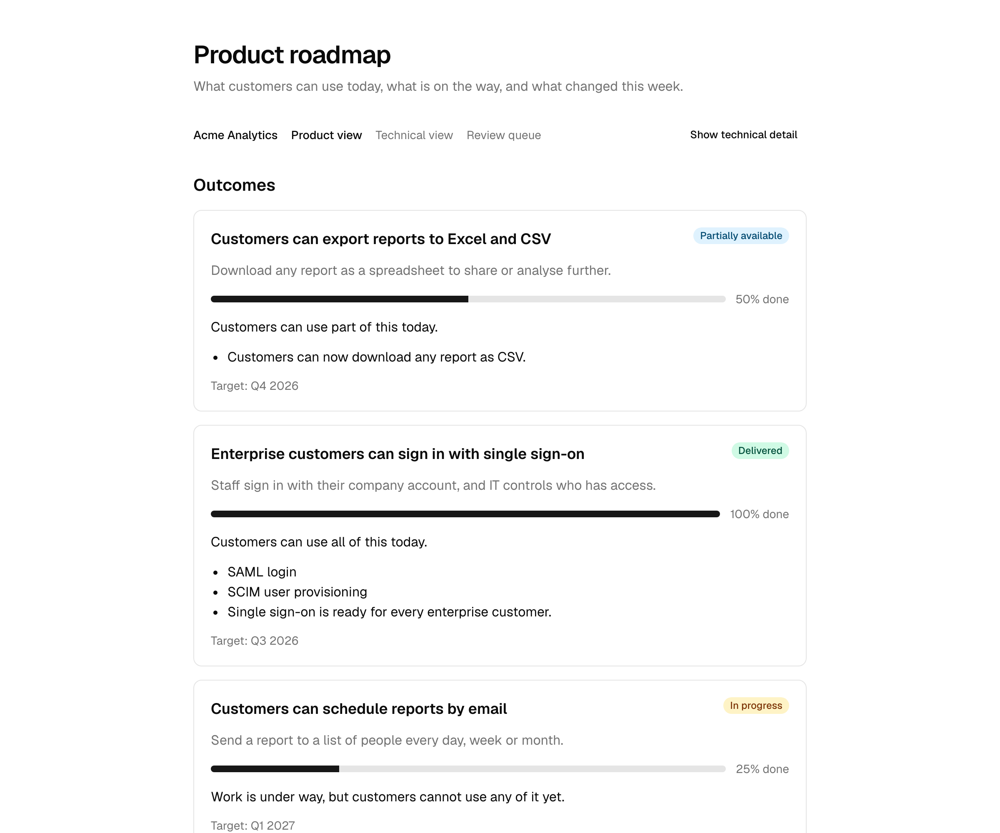
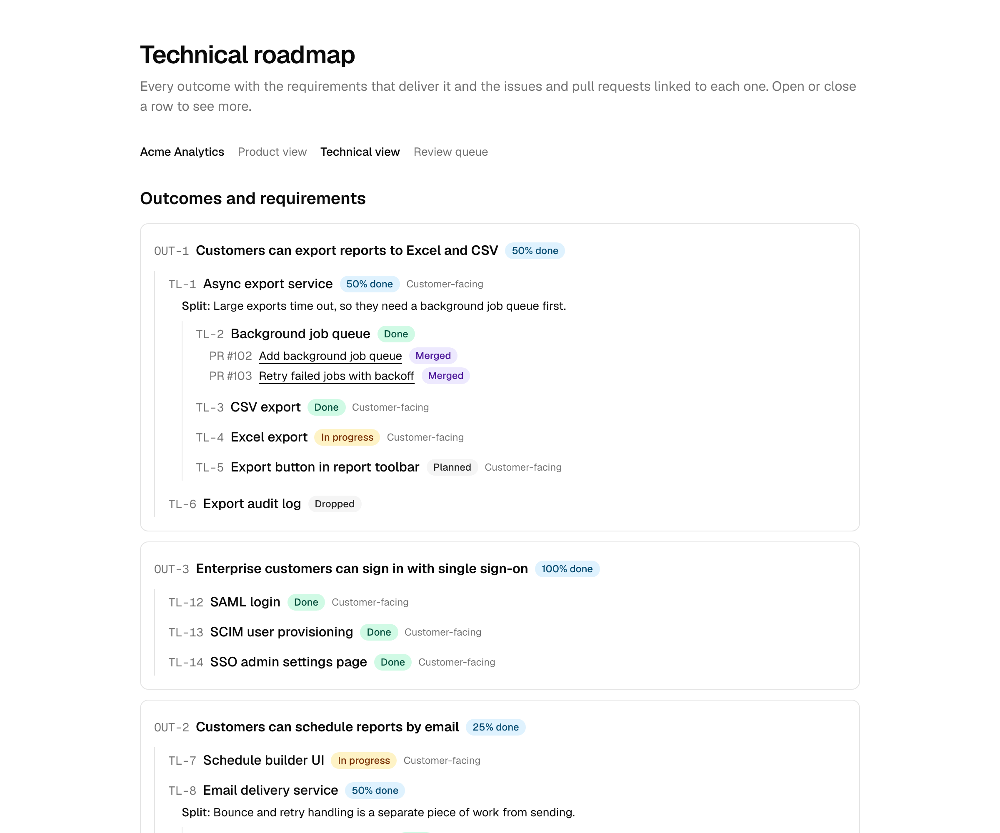
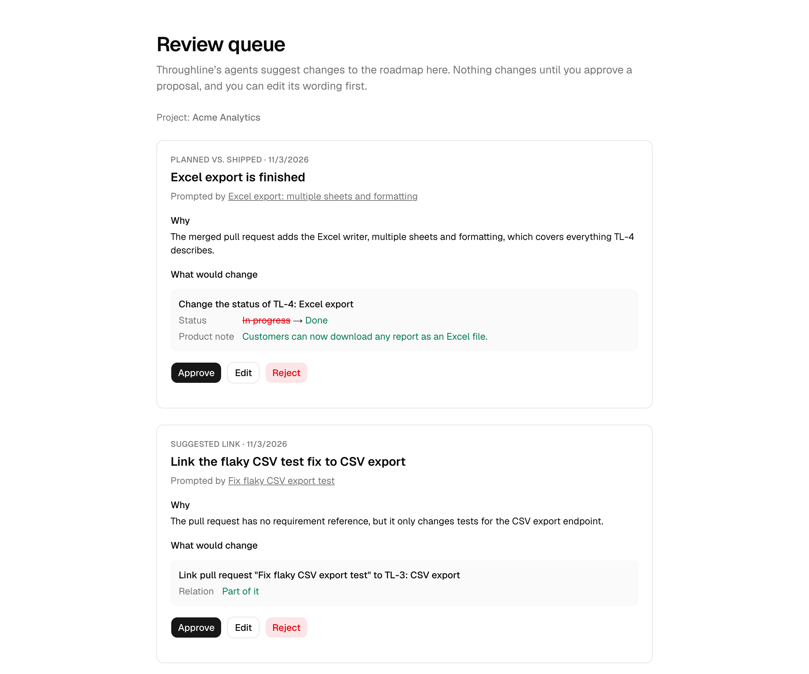

# Throughline

Traces every PR back to a customer-facing outcome, even after a requirement has split into several pieces.

**Try it:** [run it locally](#run-it-locally) in a few minutes with no accounts or keys, or [deploy your own](docs/DEPLOY.md) public demo on Vercel. Either way, **Open demo** goes straight to a sample company's roadmap with no sign-in.

## What Throughline does

Product roadmaps and engineering work drift apart. A requirement turns out to need four pieces of work instead of one, something ships differently than planned, and soon nobody outside engineering can say what customers can actually use today.

Throughline keeps them connected:

- **One source of truth.** Product outcomes, the technical requirements that deliver them, and the GitHub issues and pull requests behind those requirements live in one linked graph. The product roadmap and the technical roadmap are two views of it.
- **Plan versus reality.** When a pull request merges, an AI agent compares what was built with what was planned and proposes an update: mark it done, split it, or record that the scope grew.
- **People stay in charge.** Nothing changes until a product manager approves the proposal.
- **Plain-language status.** Sales and leadership see what is delivered, what is partially available and why plans changed, without reading tickets.

The **product view** answers "what can customers use today?" in plain language:



The **technical view** shows every requirement, how it was split, and the issues and pull requests behind it:



The **review queue** is where a person approves, edits or rejects what the agents propose:



## How it works

1. **Import a roadmap.** Paste a roadmap or planning notes. The import agent drafts product outcomes and technical requirements (`TL-1`, `TL-2`, …) as a proposal for review.
2. **Connect a repository.** A GitHub App sends Throughline every issue and pull request change. A pull request that says `Implements TL-12` or `Part of TL-12` is linked to that requirement.
3. **Reconcile when work ships.** When linked work merges, the reconciliation agent reads the pull request and the plan and proposes what changed: done, partly done, split into new pieces, or scope added. A merged pull request with no reference gets a suggested link instead.
4. **Approve.** Every proposal waits in the review queue. Approving it changes the graph and writes an event with a plain-language note, which feeds the product view's "what changed this week".
5. **Read the roadmaps.** Status rolls up from finished work to requirements to outcomes, so both views always agree.

The full design, data model and trade-offs are in [`docs/ARCHITECTURE.md`](docs/ARCHITECTURE.md).

## Run it locally

You need Node.js 22 and pnpm (`corepack enable pnpm`). No accounts or API keys are needed.

```bash
git clone https://github.com/JakobKrzyston/throughline-roadmap.git
cd throughline-roadmap
pnpm install
pnpm db:migrate   # create the tables
pnpm db:seed      # load the "Acme Analytics" demo project
pnpm dev
```

Open http://localhost:3000 and click **Open demo**. Data is stored in an embedded Postgres (PGlite) under `./.pglite`. To use a Postgres server such as Neon instead, copy `.env.example` to `.env.local` and set `DATABASE_URL`.

What to try:

- **Product view** (`/p/acme-analytics`): what customers can use today and what changed this week. **Show technical detail** adds requirement keys.
- **Technical view** (`/p/acme-analytics/tech`): the requirement tree, linked work and split history.
- **Review queue** (`/p/acme-analytics/review`): approve, edit or reject the pending proposals, then watch the product view change.
- **Import** (`/p/acme-analytics/import`): paste a roadmap. Without `ANTHROPIC_API_KEY` you get a sample proposal; set the key in `.env.local` to use Claude.
- **Settings** (`/p/acme-analytics/settings`): connect a real repository once you have set up a GitHub App as described in [`docs/GITHUB_APP.md`](docs/GITHUB_APP.md).

Checks that CI runs on every pull request:

```bash
pnpm lint && pnpm format:check && pnpm typecheck && pnpm test
pnpm exec playwright install chromium   # once
pnpm test:e2e                           # builds the app and loads the demo
```

## Design decisions

- **The AI proposes; people decide.** Every model output becomes a proposal, and only an approved proposal changes the graph. A misread pull request costs a click to reject, not a wrong roadmap.
- **Splits keep the parent link.** Splitting a requirement adds children under it, so a customer outcome never loses track of the work that delivers it.
- **Parent status is computed, never stored.** Only leaf requirements have a status; everything above is a pure function of them, so there is no rollup state to drift.
- **Every change is an event**, with who made it and a plain-language note. The "what changed" feed is just this log.
- **Integrations sit behind adapters.** GitHub is one `SourceAdapter` and Claude is one `LLMProvider`, so Linear, Jira or another model can be added without touching the core.
- **Everything works without secrets.** With no API key or GitHub App, the app uses a fake model and demo data. Tests never call real services.
- **A public site without sign-in stays safe.** With `PUBLIC_DEPLOYMENT=true`, visitors can change only the demo, which runs on sample results and resets nightly; every other project is view-only.

## Throughline on Throughline

Throughline is built to track its own build: its seven-stage plan, [`docs/PLAN.md`](docs/PLAN.md), is imported into a `throughline` project on the public site, and this repository is connected to it, so each stage's pull request updates that roadmap when it merges. The setup steps are in [`docs/DEPLOY.md`](docs/DEPLOY.md#dogfooding-throughline-tracking-its-own-roadmap).

## Built with Claude

Throughline was built with [Claude Code](https://claude.com/claude-code), one stage of [`docs/PLAN.md`](docs/PLAN.md) per pull request. [`CLAUDE.md`](CLAUDE.md) gives every session the design rules and conventions above, and each pull request was reviewed before it merged. Inside the app, the import, reconciliation and link suggestion agents call Claude through the Anthropic TypeScript SDK.

## Future work

Designed for but not built in v1; each has an issue:

- [Feedback ingestion](../../issues/8): link customer feedback to outcomes to show demand and gaps.
- [Research agent](../../issues/9): check planned approaches against current libraries and the market.
- [More sources](../../issues/10): Linear and Jira alongside GitHub.
- [Teams and permissions](../../issues/11): organisations, roles and SSO, replacing the public site's view-only rule.
- [Digests](../../issues/12): a weekly plain-language summary by Slack or email.
- [Roadmap planning](../../issues/22): reschedule and reprioritise outcomes in place.
- [Work breakdown](../../issues/23): group technical work by type, team and person.

## Learn more

- [Architecture and data model](docs/ARCHITECTURE.md)
- [Build plan](docs/PLAN.md)
- [Deploying to Vercel and Neon](docs/DEPLOY.md)
- [GitHub App setup](docs/GITHUB_APP.md)

## License

MIT. See [LICENSE](LICENSE).
