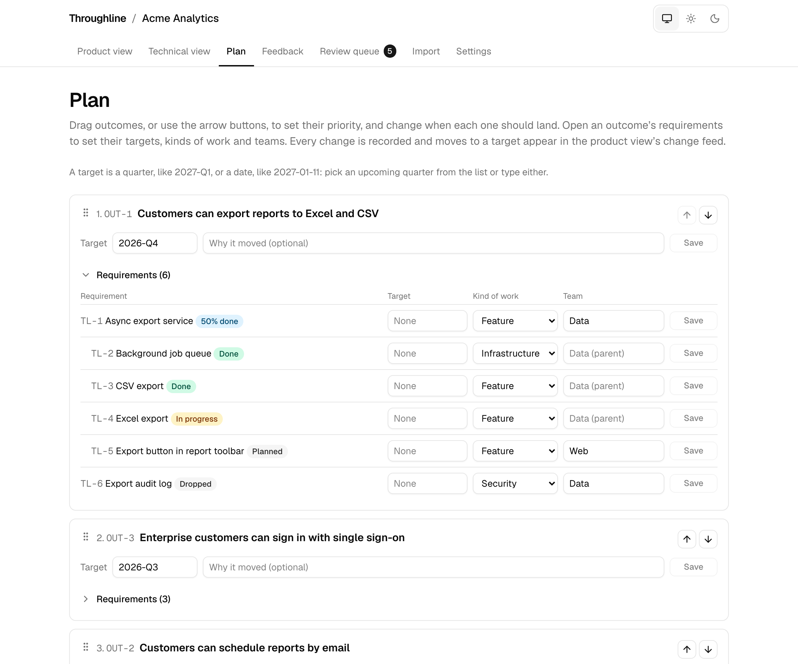
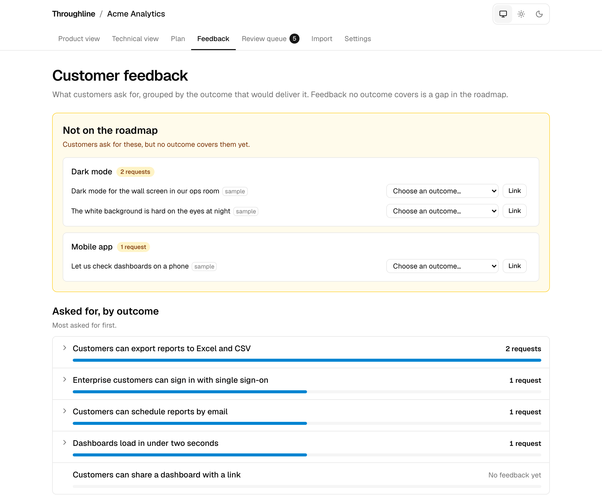

# Throughline

Traces every PR back to a customer-facing outcome, even after a requirement has split into several pieces.

**Try it:** [run it locally](#run-it-locally) in a few minutes with no accounts or keys, or [deploy your own](docs/DEPLOY.md) public demo on Vercel. Either way, the landing page previews a sample company's roadmap live, and **Open demo** goes straight to it with no sign-in.

## What Throughline does

Product roadmaps and engineering work drift apart. A requirement turns out to need four pieces of work instead of one, something ships differently than planned, and soon nobody outside engineering can say what customers can actually use today.

Throughline keeps them connected:

- **One source of truth.** Product outcomes, the technical requirements that deliver them, and the GitHub issues and pull requests behind those requirements live in one linked graph. The product roadmap and the technical roadmap are two views of it.
- **Plan versus reality.** When a pull request merges, an AI agent compares what was built with what was planned and proposes an update: mark it done, split it, or record that the scope grew.
- **People stay in charge.** Nothing changes until a product manager approves the proposal.
- **Plain-language status.** Sales and leadership see what is delivered, what is partially available and why plans changed, without reading tickets.

The **product view** answers "what can customers use today?" in plain language:


The **technical view** shows every requirement, how it was split, and the issues and pull requests behind it:


The **review queue** is where a person approves, edits or rejects what the agents propose:


The **plan** page is where a person sets priorities and targets:



The **feedback** page shows what customers ask for, and what the roadmap is missing:



## How it works

1. **Import a roadmap.** Paste a roadmap or planning notes, or upload the CSV, Markdown or HTML file that Jira, Productboard, Aha!, Linear, Notion, Confluence or a spreadsheet exports. The import agent drafts product outcomes and technical requirements (`TL-1`, `TL-2`, …) as a proposal for review. Or import straight from Linear: a team's initiatives become outcomes and its projects become requirements. Teams that keep a product roadmap and a technical roadmap can bring both: the proposal links each technical item to the outcome it delivers, shows the rows each item came from, and asks the reviewer to place anything that fits no outcome.
2. **Connect a repository.** A GitHub App sends Throughline every issue and pull request change. A pull request that says `Implements TL-12` or `Part of TL-12` is linked to that requirement, and opening it marks the requirement in progress. A connected Linear team works the same way: moving an issue to In Progress starts its requirement, and completing it counts like a merge.
3. **Reconcile when work ships.** When linked work merges, the reconciliation agent reads the pull request and the plan and proposes what changed: done, partly done, split into new pieces, or scope added. A merged pull request with no reference gets a suggested link instead.
4. **Approve.** Every proposal waits in the review queue. Approving it changes the graph and writes an event with a plain-language note, which feeds the product view's "what changed this week".
5. **Read the roadmaps.** Status rolls up from finished work to requirements to outcomes, so both views always agree.
6. **Replan when dates move.** On the plan page a person reorders outcomes and changes targets, and each change is recorded like any other. When work is due after its outcome's target, or a target passes with work still open, the slip check proposes a later target and gives the reason.
7. **Hear from customers.** An issue labelled `feedback` is customer feedback, not work. The feedback agent names what it asks for and proposes the outcome that would deliver it, so the feedback page shows how much each outcome is asked for, and feedback no outcome covers, grouped by theme, shows what the roadmap is missing.
8. **Send a weekly digest.** Every Monday a plain-language summary of what changed and where each outcome stands can go to a Slack channel, for people who never open Throughline. Set it up on a project's settings page.

The full design, data model and trade-offs are in [`docs/ARCHITECTURE.md`](docs/ARCHITECTURE.md).

## Why not just use Linear or Jira?

Linear and Jira are trackers. People create tickets, people move them, and the plan is whatever the tickets say. Both can roll a status up to an epic or a project, but they roll up a field a person set. When engineering ships something different from what the epic describes, the epic stays wrong until someone notices, and nobody outside engineering can tell. That drift is the problem, and a tracker cannot fix it because it has no source of truth apart from its own tickets.

Throughline turns the direction of truth around. The code is the record of what shipped. An agent reads the merged pull request, compares it with the plan, and proposes how the plan should change. A person's job shrinks from maintaining the plan to approving changes to it. Four things follow from that:

- **Splits are first-class and keep their history.** When one requirement turns out to be four, the original survives with the reason it was split and a plain-language note, so the product view can say why a date moved. In a tracker that becomes four new tickets and a stale parent.
- **"Partially available" is a real status.** It is computed from which finished pieces customers can actually use. It is the honest answer to the sales question "can customers use any of this yet?", and no tracker has it.
- **The changelog is written for non-engineers as a side effect of engineering.** Every approved change carries a product note, and the "what changed this week" feed is built from those notes. A tracker's history is field changes per ticket.
- **The write model is built for agents.** Every change is a typed operation, every operation is an event, and every agent output is a proposal. Adding an agent that reads customer feedback or checks planned approaches against current libraries is a new proposal source, not a new subsystem.

Throughline is not a tracker and should not grow into one. It has no sprints, assignees or estimates. It is a layer above the tracker and the repository that answers one question trustworthily: what have we promised, and what has actually shipped?

## Who it is for

**A small team**, a few engineers and a founder acting as product manager. The roadmap document goes stale two weeks after it is written, and the founder cannot tell investors or customers what has shipped. Throughline's offer is a roadmap that maintains itself for a few minutes of review a week: paste the roadmap, connect the repository, reference requirement keys in pull requests, approve proposals. The product view doubles as the changelog and the investor update. For a team whose tracker is GitHub Issues, Throughline can be the whole roadmap layer.

**A large organisation**, many teams, many product managers, a sales enablement function. Here the drift is organisational. Leadership keeps a roadmap in slides, each team keeps its own board, sales was told a quarter and the feature shipped two quarters later at half scope. "Is this available for that customer?" is a chat question answered from memory. Reconciling the plan from the diff scales where human discipline does not: nobody updates the epic, but the diff is always there. Splits with lineage handle outcomes that fracture across teams, and the event log gives an auditable answer to "when did this slip and why", captured at the moment of the pull request rather than reconstructed in a retrospective. To get there, Throughline needs Linear and Jira adapters, organisations and ownership routing so each proposal reaches the right product manager, and tiered approval so high-confidence results can be batch-approved while splits and scope changes still get a person. Those are listed under [Future work](#future-work).

**The wider bet.** As more code is written by agents, "who updated the ticket?" gets worse, because the author of the code never had a ticket. Reconciling the plan from what was actually built is the approach that still works when the author is a machine. If that holds, a tracker's status field becomes derived data, and the thing organisations need, a trustworthy map from customer promises to shipped code, becomes the primary artifact.

## Run it locally

You need Node.js 22 and pnpm (`corepack enable pnpm`). No accounts or API keys are needed.

```bash
git clone https://github.com/JakobKrzyston/throughline-roadmap.git
cd throughline-roadmap
pnpm install
pnpm db:migrate   # create the tables
pnpm db:seed      # load the "Acme Analytics" demo project
pnpm dev
```

Open http://localhost:3000. The landing page shows one demo outcome live in the product view, the technical view and the review queue; click **Open demo** for the whole project. Data is stored in an embedded Postgres (PGlite) under `./.pglite`. To use a Postgres server such as Neon instead, copy `.env.example` to `.env.local` and set `DATABASE_URL`. To go back to PGlite while `.env.local` points at Neon, run `export DATABASE_URL="" DATABASE_URL_UNPOOLED=""` in the shell first.

What to try:

- **Product view** (`/p/acme-analytics`): how many outcomes are delivered, partially available, in progress and not started, then each outcome under its target quarter with what customers can use today and what is still to come, beside what changed this week. **Show technical detail** adds requirement keys.
- **Technical view** (`/p/acme-analytics/tech`): the requirement tree with linked work, progress by team and split history. Open or close any row, and filter by kind of work, team and person. The demo's issues and pull requests are made up, so they are marked "sample" instead of linking to GitHub.
- **Plan** (`/p/acme-analytics/plan`): drag outcomes, or use the arrow buttons, into a new priority order, change targets in place by picking a quarter or typing a date, and set each requirement's target, kind of work and team; each move shows up in the product view's change feed. Work due after its outcome's target is flagged.
- **Feedback** (`/p/acme-analytics/feedback`): requests no outcome covers come first, grouped by theme, then how much each outcome is asked for. Link a request to an outcome yourself, or review the match an agent suggested.
- **Review queue** (`/p/acme-analytics/review`): five pending proposals, one of each kind: an imported outcome, shipped work, a suggested link, a feedback match and a target at risk. Approve, edit or reject one; it is confirmed in place with a link to where the change shows.
- **Import** (`/p/acme-analytics/import`): paste a roadmap or upload an exported file (`.md`, `.txt`, `.csv` or `.html`, up to 500 KB and 50,000 characters of text), or load a sample Jira CSV, Productboard CSV or Notion Markdown export with its real-world noise. Without a model key each sample gets a proposal written for it and anything else gets one generic sample proposal; set `ANTHROPIC_API_KEY` in `.env.local` to use Claude, or `OPENROUTER_API_KEY` to use a free model through OpenRouter. **Product and technical roadmap** imports the two together; without a model key only its sample (an Acme product roadmap and a Jira export) can be imported this way. **Import from Linear** reads a sample Linear workspace until you set `LINEAR_API_KEY` ([`docs/LINEAR.md`](docs/LINEAR.md)); demo projects always read the sample.
- **Settings** (`/p/acme-analytics/settings`): read the next weekly digest as it stands, and connect a real repository once you have set up a GitHub App as described in [`docs/GITHUB_APP.md`](docs/GITHUB_APP.md), and connect the sample Linear team `ENG` to see Linear issues tracked as work items (a real team needs `LINEAR_API_KEY`; see [`docs/LINEAR.md`](docs/LINEAR.md)).

Every page works on a phone and follows your system's light or dark theme; the control in the top bar overrides it.

Checks that CI runs on every pull request:

```bash
pnpm lint && pnpm format:check && pnpm typecheck && pnpm test
pnpm exec playwright install chromium   # once
pnpm test:e2e                           # builds the app and loads the demo
```

`pnpm test:e2e` always uses its own PGlite database in `./.pglite-e2e`, whatever `.env.local` contains.

On a Vercel production build, `pnpm build` first checks that the production database has every migration in the commit and fails, naming the missing files, if it does not. The previous deployment keeps serving. The check never migrates; see "Migrate before you merge" in [`docs/DEPLOY.md`](docs/DEPLOY.md#2-create-the-tables-and-the-demo).

## Design decisions

- **The AI proposes; people decide.** Every model output becomes a proposal, and only an approved proposal changes the graph. A misread pull request costs a click to reject, not a wrong roadmap.
- **Splits keep the parent link.** Splitting a requirement adds children under it, so a customer outcome never loses track of the work that delivers it.
- **Parent status is computed, never stored.** Only leaf requirements have a status; everything above is a pure function of them, so there is no rollup state to drift.
- **Every change is an event**, with who made it and a plain-language note. The "what changed" feed is just this log.
- **Integrations sit behind adapters.** GitHub and Linear are two `SourceAdapter`s. Claude and OpenRouter are two `LLMProvider`s, so Jira or another model can be added without touching the core.
- **Everything works without secrets.** With no model key, GitHub App or Linear key, the app uses a fake model, demo data and a sample Linear workspace. Tests never call real services.
- **A public site without sign-in stays safe.** With `PUBLIC_DEPLOYMENT=true`, visitors can change only the demo: its agents run on a free OpenRouter model or on sample results and never on the Anthropic key, proposals can be approved or rejected but not edited, and it resets nightly. Every other project is view-only. The whole site fits the free tiers of Vercel, Neon and OpenRouter; see [`docs/DEPLOY.md`](docs/DEPLOY.md#running-it-for-free).

## Throughline on Throughline

Throughline is built to track its own build: its seven-stage plan, [`docs/PLAN.md`](docs/PLAN.md), is imported into a `throughline` project on the public site, and this repository is connected to it, so each stage's pull request updates that roadmap when it merges. The setup steps are in [`docs/DEPLOY.md`](docs/DEPLOY.md#dogfooding-throughline-tracking-its-own-roadmap).

## Built with Claude

Throughline was built with [Claude Code](https://claude.com/claude-code): first one stage of [`docs/PLAN.md`](docs/PLAN.md) per pull request, then issue by issue. [`CLAUDE.md`](CLAUDE.md) gives every session the design rules and conventions above, and each pull request was reviewed before it merged. Inside the app, the import, reconciliation, slip check, link suggestion and feedback agents call Claude through the Anthropic TypeScript SDK, or any OpenRouter model through a second provider that the public demo uses with a free model.

## Future work

Designed for but not built yet; each has an issue:

- [Research agent](../../issues/9): check planned approaches against current libraries and the market.
- [More sources](../../issues/10): Jira alongside GitHub and Linear. Importing a roadmap from Linear and tracking Linear issues as work items work today; per-project Linear OAuth is still to come.
- [Teams and permissions](../../issues/11): organisations, roles and SSO, replacing the public site's view-only rule.

Two built features have a second half still to come: feedback from support and CRM tools (GitHub issues labelled `feedback` work today), and the weekly digest by email (Slack works today).

## Learn more

- [Architecture and data model](docs/ARCHITECTURE.md)
- [Build plan](docs/PLAN.md)
- [Deploying to Vercel and Neon](docs/DEPLOY.md)
- [GitHub App setup](docs/GITHUB_APP.md)
- [Linear setup: roadmap import and work items](docs/LINEAR.md)

## License

MIT. See [LICENSE](LICENSE).
